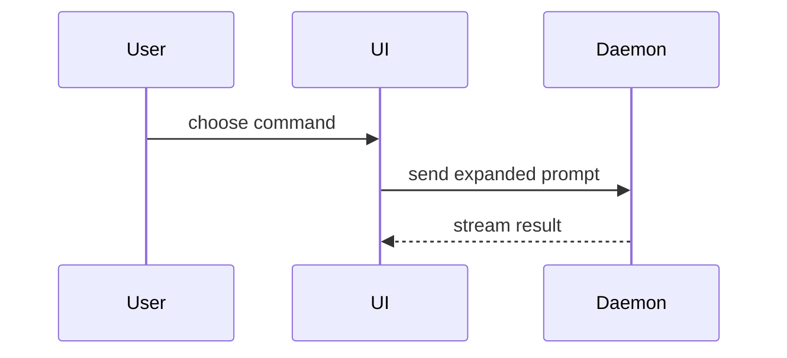

---
name: pr-review
description: "Use when reviewing a PR someone else opened — restates it as a Summary/Evidence/Merge Danger readout and gives a merge recommendation."
---
Reviewing a PR you didn't write. The author's own description may be thin, stale, or missing — read the diff yourself and write your own readout from it.

## Step 1: Fetch the PR

Identify the PR from the user's message (number or URL), or default to the current branch's PR.

```bash
gh pr view <pr> --json number,title,url,baseRefName,headRefName,author,body
gh pr diff <pr>
gh pr checks <pr>
```

`gh pr checks` may error when the repo has no configured checks — ignore that failure and proceed without CI evidence.

## Step 2: Write the readout

Use this template, filling each section from the diff — not from the author's description:

```markdown
## Summary

<diagram, diff-sketch, or tree>

## Evidence

- **Found:** <tests touched, CI status from `gh pr checks`>
  **Missing:** <what's untested or unverified — don't invent evidence that isn't there>

## Merge Danger

**Door:** <one-way or two-way>

<optional: description>

**Blast Radius:** <one-word description>

<optional: potential ramifications of merge>
```

### Summary

Pick the smallest view that makes the key point clear.

- Show logic or an algorithm as pseudocode:

```text
on(save)
  if content is unchanged
    return cached result
  write new content
  return fresh result
```

- Show runtime control flow as a call tree:

```text
submitForm
  createSession
    persistPrompt
    launchAgent
  navigateToSession
```

- Show UI structure as a component tree, including state and module boundaries that matter:

```text
<SessionPage> (apps/example/src/routes/session.tsx)
  useSessionEvents()
  <SessionToolbar>
    <RunSkillButton> (packages/ui)
```

- Show file responsibility or a broad refactor as a shallow file tree:

```text
src/
├── commands/       # parses user actions
├── sessions/       # owns session state
└── transport/      # sends API requests
```

- Show component interaction, control flow, or data flow with Mermaid:



- Use `diff` when the point is what changes and the surrounding shape already exists. Match the diff shape to the topic.

For a component change:

```diff
 <SessionPage>
   useSessionEvents()
   <SessionToolbar>
+    <RunSkillButton />
   <SessionTimeline>
+    <SkillResultCard />
```

For a file-layout change:

```diff
 src/
 ├── commands/
+│   └── show-me.ts       # expands the slash command
 ├── sessions/
-└── transport.ts
+└── transport/
+    ├── client.ts
+    └── stream.ts
```

For a call-tree or call-stack change:

```diff
 submitForm
   createSession
     persistPrompt
+    expandSkillMention
     launchAgent
-  navigateToSession
+  navigateToSession
+    subscribeToEvents
```

For a state or control-flow change:

```diff
 on(save)
-  write content
+  if content is unchanged
+    return cached result
+  write new content
+  invalidate cache
```

- Show the whole block when most of it is new, when omitted context would hide ownership or order, or when the user needs a copyable target shape:

```ts
function expandSkill(command: string): string {
  const skillName = command.slice(1);
  return `use the ${skillName} skill`;
}
```

Place each visual next to the short text it supports. Keep only the calls, files, props, states, and boundaries needed to show what this PR changes. Use one, use several — don't use all of them for one PR.

### Evidence

What in the diff or `gh pr checks` shows the change works, and what doesn't. Found: tests touched, CI status, screenshots the author attached. Missing: no tests for the new path, CI not configured, a claim in the description nothing in the diff backs up. Don't credit the PR with evidence it doesn't have.

### Merge Danger

Whether it's a one-way or two-way door. You can walk back through two-way doors, but not one-way doors. A PR that's cheap to roll back is lower risk. Changes that involve destructive actions (migrations, deletions, irreversible API calls) or hard-to-reverse decisions are one-way doors.

The blast radius is the potential impact or scope of the change. Consider all possibilities: breakages for consumers, layout shift, mobile responsiveness, data loss, etc.

## Step 3: Recommend

State one of: **Approve**, **Request changes**, **Needs discussion** — with the specific reasons, each tied to a line in the readout (a correctness issue, missing evidence, an unjustified one-way door). Surface concrete bugs or omissions you find in the diff even if the user didn't ask about them specifically.

## Step 4: Post only on request

Default to reporting the readout and recommendation in chat. Only run `gh pr review` (approve, comment, or request-changes) if the user explicitly asks — posting a review is public and hard to reverse.
